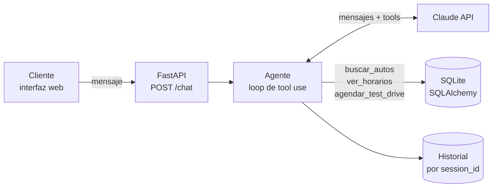

# 🚗 Asistente de concesionaria con IA (Claude + tool use)

Asistente conversacional para una concesionaria de autos. El cliente escribe en lenguaje natural ("¿qué SUV tenés por menos de 30 mil?", "quiero probar el Polo el sábado") y **Claude decide qué funciones del backend llamar** para consultar el stock, ver horarios libres y agendar test drives reales en una base de datos.

> Proyecto de portfolio: integración de LLMs con sistemas reales (tool use), automatización de un proceso comercial y experiencia de usuario conversacional.

## Qué hace

- **Búsqueda por lenguaje natural**: filtra por tipo, marca, precio, combustible y stock.
- **Consulta de disponibilidad**: detecta turnos ocupados y ofrece horarios libres.
- **Agenda test drives**: pide los datos faltantes, confirma con el cliente y escribe en la base.
- **Memoria de conversación persistente**: sobrevive a reinicios del servidor.
- **Casos borde controlados**: auto sin stock (ofrece alternativas del mismo tipo), días sin atención, preguntas ajenas al negocio.

## Arquitectura



**Stack:** Python · FastAPI · SQLAlchemy + SQLite · Anthropic SDK · HTML/JS.

## Cómo funciona el tool use

1. El backend envía a Claude el historial, el *system prompt* y la definición de las herramientas (nombre, descripción y JSON schema de parámetros).
2. Si Claude necesita datos, responde con un bloque `tool_use` indicando qué función llamar y con qué argumentos.
3. El backend **ejecuta la función real** contra la base de datos y devuelve el resultado como `tool_result`.
4. Se repite el loop hasta que Claude responde con texto final para el cliente.

| Herramienta | Qué hace |
|---|---|
| `buscar_autos` | Consulta autos por tipo, marca, precio máximo, etc. |
| `ver_horarios` | Devuelve los horarios libres de un auto en una fecha |
| `agendar_test_drive` | Valida disponibilidad y crea el turno en la base |

Principio de diseño: **Claude nunca inventa datos**. Precios, stock y horarios salen siempre de las herramientas; el modelo solo interpreta la intención y redacta la respuesta.

## Instalación

```bash
git clone <URL-DEL-REPO>
cd concesionaria-ia
python -m venv venv
source venv/bin/activate        # Windows: venv\Scripts\activate
pip install -r requirements.txt
cp .env.example .env            # y completá ANTHROPIC_API_KEY
python -m app.seed              # crea la base con autos de ejemplo
uvicorn app.main:app --reload
```

Abrí http://localhost:8000. Probar la API directamente:

```bash
curl -X POST localhost:8000/chat -H "Content-Type: application/json" \
  -d '{"session_id":"demo1","mensaje":"¿Qué SUV tenés por menos de 30 mil?"}'
```

## Seguridad

La API key vive en `.env` (ignorado por git). Nunca se sube al repositorio.
